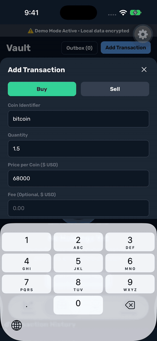
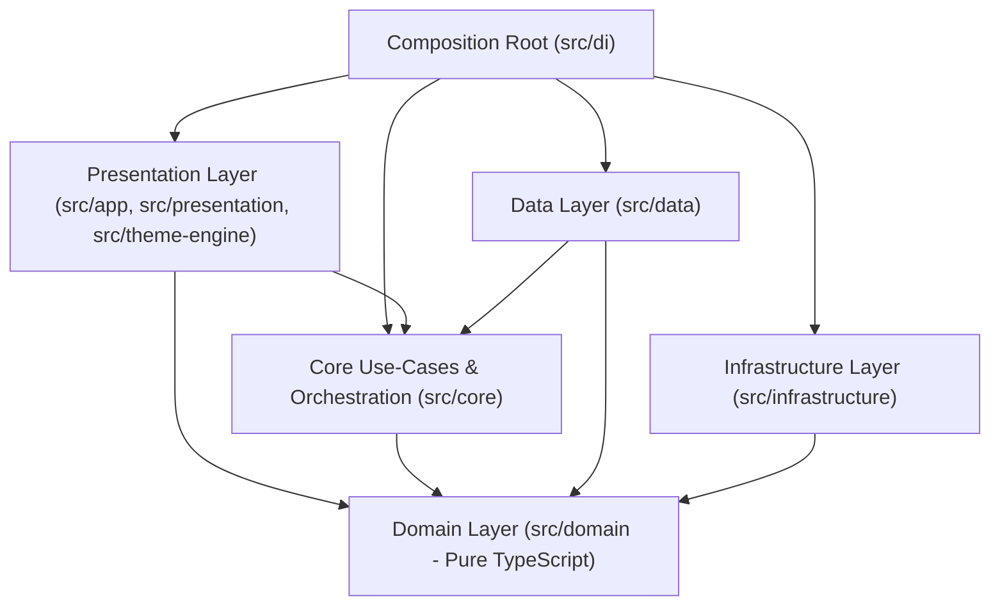
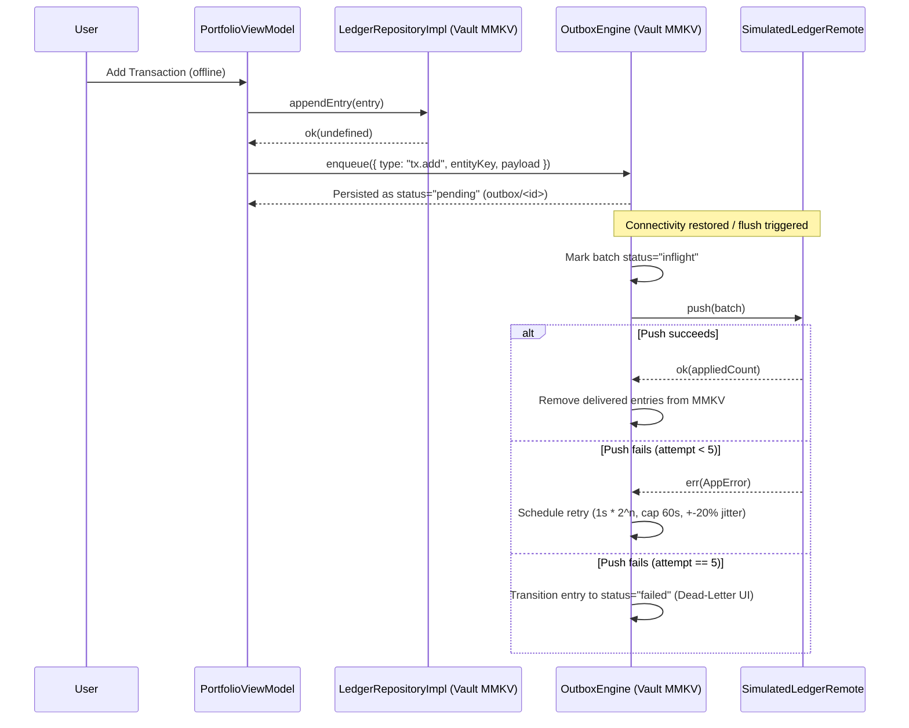

# VaultFold

**Offline-first, local-only cryptocurrency portfolio tracker and market explorer built with Expo SDK 58 (React Native 0.88, New Architecture), strict TypeScript 6, Clean Architecture, MMKV AES-256 storage, and arbitrary-precision decimal arithmetic.**

[](https://github.com/muhammedelnady/VaultFold/actions/workflows/ci.yml)
[](LICENSE)

<p align="center">
  
  &nbsp;
  
  &nbsp;
  
  &nbsp;
  
</p>

---

## 1. Reviewer's Guide (5-Minute Tour)

Run the entire verification gate (EAS profile guard, `tsc --noEmit`, ESLint layer boundary & RTL checks, i18n key-parity check, and Jest coverage suite) with a single command:

```bash
npm run verify
```

| Concern                                  | Implementation Files                                                                                                                                                                           | Verification / Tests                                                                                                                                                                   |
| :--------------------------------------- | :--------------------------------------------------------------------------------------------------------------------------------------------------------------------------------------------- | :------------------------------------------------------------------------------------------------------------------------------------------------------------------------------------- |
| **Clean Architecture & DI**              | `eslint.config.js`, `src/domain/Result.ts`, `src/di/container.ts`, `src/di/AppProviders.tsx`                                                                                                   | `src/di/container.test.ts`, `src/di/AppProviders.test.tsx`                                                                                                                             |
| **Financial Math (`decimal.js-light`)**  | `src/domain/portfolio/PortfolioCalculation.ts`, `src/core/use-cases/currency-converter.ts`                                                                                                     | `src/domain/portfolio/PortfolioCalculation.test.ts`, `src/core/use-cases/currency-converter.test.ts`                                                                                   |
| **Offline-First & Outbox Engine**        | `src/core/offline/outbox-engine.ts`, `src/core/offline/mmkv-persister.ts`, `src/data/remote/simulated-ledger-remote.ts`                                                                        | `src/core/offline/outbox-engine.test.ts`, `src/core/offline/outbox-engine.offline.test.ts`                                                                                             |
| **Security, Key Lifecycle & Biometrics** | `src/infrastructure/security/vault-key.ts`, `src/infrastructure/storage/mmkvInstances.ts`, `src/infrastructure/security/ExpoBiometricsService.ts`, `src/presentation/stores/vaultAuthStore.ts` | `src/infrastructure/security/vault-key.test.ts`, `src/infrastructure/storage/mmkvInstances.test.ts`, `src/presentation/stores/vaultAuthStore.test.ts`, `scripts/check-eas-profiles.js` |
| **Network Rate-Limiting & Zod Schemas**  | `src/core/network/token-bucket.ts`, `src/core/network/retry-policy.ts`, `src/data/api/coingecko-schemas.ts`                                                                                    | `src/core/network/http-client-priority-fault.test.ts`, `src/data/api/coingecko-schemas.test.ts`                                                                                        |
| **Skia Charts, LTTB & Foldable UI**      | `src/presentation/components/market/lttb.ts`, `src/presentation/components/coin/InteractiveChart.tsx`, `src/core/foldable/AdaptiveDualPane.tsx`                                                | `src/presentation/components/market/lttb.test.ts`, `src/core/foldable/posture.test.ts`                                                                                                 |
| **CI/CD & Quality Gates**                | `.github/workflows/ci.yml`, `jest.config.js`, `scripts/validate-i18n.js`                                                                                                                       | `.maestro/smoke.yaml`, `.maestro/offline-queue-and-sync.yaml`                                                                                                                          |

---

## 2. Overview

### The Problem

Mobile portfolio trackers frequently suffer from three failure modes:

1. **Floating-point drift:** Using IEEE-754 `number` for token quantities, fees, and fiat conversions introduces rounding errors (`0.1 + 0.2 !== 0.3`).
2. **Fragile offline behavior:** Mutations made on flaky mobile connections either block the UI or silently drop when the app is backgrounded or killed.
3. **Unnecessary data exposure:** Storing portfolio ledgers in unencrypted key-value stores or syncing personal holdings to third-party servers.

### The Solution & Scope

VaultFold pairs a read-only public market explorer (powered by the CoinGecko REST API with local token-bucket rate limiting and Zod runtime validation) with an encrypted local portfolio ledger:

- **Append-only ledger (`src/data/ledger/LedgerRepositoryImpl.ts`):** Edits append revision entries (`prevId`); deletes append tombstones.
- **Persistent Outbox (`src/core/offline/outbox-engine.ts`):** Queues mutations offline with exponential backoff (`1s` to `60s` cap), `±20%` jitter, watchlist-toggle coalescing, startup orphan recovery (`recoverOrphans()`), and dead-letter transition after 5 failed attempts.
- **Multi-currency & Arabic RTL:** Supports USD, EUR, SAR, and EGP (computed via BTC cross-rate in `src/core/use-cases/currency-converter.ts` because CoinGecko's `/coins/markets` endpoint does not support `vs_currency=egp`), plus live English/Arabic RTL switching.

### Explicit Non-Goals & What VaultFold Never Does

- **Never touches private keys, seed phrases, or on-chain signing:** VaultFold is strictly a manual portfolio ledger and market explorer, not a wallet.
- **Never transmits portfolio data over the network:** There is no cloud backend or user account system. Outbox synchronization runs against an on-device simulated remote (`src/data/remote/simulated-ledger-remote.ts`) to exercise and test the full offline-sync state machine end-to-end.
- **No analytics or crash telemetry SDKs:** No third-party analytics or crash-reporting libraries are installed in `package.json`.

---

## 3. Architecture

VaultFold enforces a unidirectional dependency rule via ESLint (`eslint.config.js`): `src/domain/**` imports zero React, React Native, Expo, MMKV, network, or outer-layer modules, and boundary crossings return `Result<T, AppError>` rather than throwing exceptions.



### Annotated Folder Tree

```text
VaultFold/
├── .github/workflows/          # CI pipeline (ci.yml) + manual dispatch workflows
├── .maestro/                   # 9 Maestro E2E flows (smoke, offline sync, RTL, foldable)
├── __fixtures__/coingecko/     # Captured CoinGecko JSON responses for contract & E2E tests
├── scripts/
│   ├── check-eas-profiles.js   # Blocks EXPO_PUBLIC_E2E outside the e2e EAS profile
│   └── validate-i18n.js        # Enforces 100% en/ar translation key parity (183 keys)
└── src/
    ├── app/                    # Expo Router v4 file-based routes ((tabs), market/[coinId])
    ├── core/
    │   ├── foldable/           # Posture classification (compact, flat, book, tabletop)
    │   ├── network/            # TokenBucket rate limiter, retry policy, HttpClient
    │   ├── offline/            # OutboxEngine, MMKV TanStack Query persister, connectivity
    │   └── use-cases/          # Alert evaluation, USD->EGP cross-rate converter
    ├── data/
    │   ├── alert/              # AlertRepositoryImpl (encrypted vault MMKV)
    │   ├── api/                # CoinGecko client + Zod runtime schemas
    │   ├── coin/               # CoinRepositoryImpl
    │   ├── ledger/             # LedgerRepositoryImpl (append-only ledger + watchlist)
    │   ├── market/             # MarketRepositoryImpl
    │   └── remote/             # SimulatedLedgerRemote (deterministic sync target)
    ├── di/                     # Typed DI container + AppProviders bootstrap/recovery UI
    ├── domain/                 # Pure TS entities, repository ports, Result<T, AppError>, Decimal math
    ├── infrastructure/
    │   ├── i18n/               # English & Arabic dictionaries + RTL helpers
    │   ├── monitoring/         # Environment variable validation
    │   ├── security/           # Vault key lifecycle (SecureStore) & ExpoBiometricsService
    │   └── storage/            # MMKV instances (cache, AES-256 vault, remote-sim)
    ├── presentation/           # Screens, MVVM viewmodels, Zustand stores, Skia charts
    └── theme-engine/           # Light/dark tokens & theme hooks
```

### Offline Mutation -> Outbox -> Sync Sequence



---

## 4. Key Engineering Decisions (ADR Summary)

| Decision                                                                                                                  | Alternatives Considered                                           | Why Chosen                                                                                                                                                                                                                                                                                                                  | Trade-Off Accepted                                                                                                     |
| :------------------------------------------------------------------------------------------------------------------------ | :---------------------------------------------------------------- | :-------------------------------------------------------------------------------------------------------------------------------------------------------------------------------------------------------------------------------------------------------------------------------------------------------------------------- | :--------------------------------------------------------------------------------------------------------------------- |
| **Discriminated `Result<T, AppError>` across boundaries** (`src/domain/Result.ts`)                                        | Throwing exceptions; untyped error strings                        | Makes failure paths explicit in TypeScript signatures and prevents unhandled promise rejections in UI hooks.                                                                                                                                                                                                                | Slight verbosity at call sites compared to `try/catch`.                                                                |
| **`decimal.js-light` for all portfolio math** (`src/domain/portfolio/PortfolioCalculation.ts`)                            | Native JS `number`; `BigInt` scaled integers                      | Eliminates IEEE-754 drift across arbitrary decimal places and supports division/percentage P&L directly; serializes cleanly as decimal strings in JSON.                                                                                                                                                                     | Slower than hardware floats, though negligible for hundreds of ledger entries.                                         |
| **Dual MMKV instances (`cache` unencrypted, `vault` explicit `AES-256`)** (`src/infrastructure/storage/mmkvInstances.ts`) | Single SQLite DB; AsyncStorage; MMKV default encryption           | Synchronous JSI reads/writes; separating public market cache from the vault keeps startup cache hydration fast while encrypting user data with a 32-byte key in `SecureStore` (`WHEN_UNLOCKED_THIS_DEVICE_ONLY`). Note: `react-native-mmkv` v4 defaults to AES-128 unless `encryptionType: "AES-256"` is passed explicitly. | MMKV does not provide multi-key ACID transactions (see Known Limitations).                                             |
| **Distinct key-read failure vs. key-loss recovery** (`src/infrastructure/security/vault-key.ts`)                          | Generating a new key on any `SecureStore` error                   | Generating a key when `SecureStore` is temporarily unreadable (e.g., locked device) would silently orphan an existing encrypted vault. `ensureVaultKey` returns `ready`, `unavailable` (retryable, nothing cached/overwritten), or `recovery` (explicit user reset).                                                        | Requires a dedicated recovery screen in `AppProviders.tsx` before DI finishes.                                         |
| **Biometrics as an application-level lock (`ExpoBiometricsService.ts`)**                                                  | Binding the `SecureStore` item with `requireAuthentication: true` | Allows background/boot container initialization and localized lock-screen UI with configurable grace timeouts (`vaultAuthStore.ts`).                                                                                                                                                                                        | On a rooted/jailbroken device with Frida, an attacker can hook the JS boolean gate without biometric hardware prompts. |
| **Cloud backup disabled (`allowBackup: false` / `WHEN_UNLOCKED_THIS_DEVICE_ONLY`)**                                       | Allowing iOS/Android cloud backups of app data                    | Prevents encrypted MMKV files from being restored to a new device without their non-migrating Keychain/Keystore key.                                                                                                                                                                                                        | Users cannot restore their local portfolio onto a new phone automatically.                                             |

---

## 5. Security Model & OWASP MASVS v2 Mapping

### Vulnerability Reporting

If you discover a security vulnerability in this repository, please report it privately via **GitHub Private Vulnerability Reporting** (`Security` tab -> `Report a vulnerability`) rather than opening a public issue.

### Threat Model Summary

- **Protected Assets:** Local transaction ledger (`ledger.entries.v1`), watchlist (`watchlist.v1`), price alerts (`alerts.v1`), and pending outbox mutations (`outbox/*`).
- **Trust Boundaries:**
  1. **Device Storage Boundary:** Vault MMKV file on disk vs. the 32-byte key stored in `expo-secure-store` (`WHEN_UNLOCKED_THIS_DEVICE_ONLY`).
  2. **External Network Boundary:** Untrusted JSON payloads from `https://api.coingecko.com/api/v3/*` validated at runtime via Zod schemas (`src/data/api/coingecko-schemas.ts`).
  3. **Build / Environment Boundary:** `EXPO_PUBLIC_*` variables are embedded in the JavaScript bundle by design and are treated as public configuration, never secrets. A CI check (`scripts/check-eas-profiles.js`) verifies that `EXPO_PUBLIC_E2E` (which swaps `ExpoBiometricsService` for `StubBiometricsService` during automated UI tests) is never present in non-`e2e` EAS profiles.

### OWASP MASVS v2 Control Matrix

| MASVS Category       | Status           | Evidence in Repo                                                                                    | Notes / Limitations                                                                                                                                                                                        |
| :------------------- | :--------------- | :-------------------------------------------------------------------------------------------------- | :--------------------------------------------------------------------------------------------------------------------------------------------------------------------------------------------------------- |
| **MASVS-STORAGE**    | **Implemented**  | `src/infrastructure/storage/mmkvInstances.ts`, `app.json` (`allowBackup: false`)                    | Sensitive data lives in the `vaultfold-vault` MMKV instance encrypted with explicit `AES-256`. Android backup is disabled (`allowBackup: false`); iOS Keychain item uses `WHEN_UNLOCKED_THIS_DEVICE_ONLY`. |
| **MASVS-CRYPTO**     | **Implemented**  | `src/infrastructure/security/vault-key.ts`                                                          | 32-character ASCII key (32 bytes, 192 bits of entropy from `expo-crypto` `getRandomBytes(32)`) stored in `expo-secure-store`. No hardcoded keys or custom primitives.                                      |
| **MASVS-AUTH**       | **Partial**      | `src/infrastructure/security/ExpoBiometricsService.ts`, `src/presentation/stores/vaultAuthStore.ts` | App-level biometric/passcode lock (`LocalAuthentication.authenticateAsync`) with configurable `AppState` background auto-lock timeouts. Key is not hardware-prompt-bound via `requireAuthentication`.      |
| **MASVS-NETWORK**    | **Partial**      | `src/core/network/http-client.ts`, `src/data/api/coingecko-schemas.ts`                              | HTTPS-only endpoints, `AbortController` timeouts, token-bucket rate limiting, and Zod schema validation. Certificate pinning is out of scope because the app only queries the public CoinGecko API.        |
| **MASVS-PLATFORM**   | **Implemented**  | `src/di/AppProviders.tsx` (`expo-screen-capture`), `app.json`                                       | Minimal native permissions (`android.permissions: []`), screen-capture prevention enabled by default, and explicit iOS `NSPrivacyAccessedAPITypes` declarations.                                           |
| **MASVS-CODE**       | **Implemented**  | `tsconfig.json`, `eslint.config.js`, `package-lock.json`                                            | TypeScript `strict: true` + `noUncheckedIndexedAccess: true`, zero `@ts-ignore`, and automated dependency auditing in CI.                                                                                  |
| **MASVS-RESILIENCE** | **Out of Scope** | —                                                                                                   | No jailbreak/root detection or JS obfuscation; open-source client with no server-side secrets.                                                                                                             |
| **MASVS-PRIVACY**    | **Implemented**  | `app.json` (`NSPrivacyTracking: false`), `package.json`                                             | Zero third-party analytics, advertising, or crash-reporting SDKs; all portfolio data remains on-device.                                                                                                    |

---

## 6. Offline-First Design & Failure Modes

- **Delivery & Idempotency:** Mutations (`tx.add`, `tx.edit`, `tx.delete`, `watch.toggle`, `alert.upsert`, `alert.delete`) are assigned unique IDs and replayed FIFO per `entityKey` against `LedgerRemote`. `SimulatedLedgerRemote` (`src/data/remote/simulated-ledger-remote.ts`) tracks applied mutation IDs (`appliedIds`) so duplicate deliveries are idempotent no-ops.
- **Coalescing:** Redundant `watch.toggle` entries for the same `coinId` that are still `pending` are coalesced in place before network dispatch (`src/core/offline/outbox-engine.ts`).
- **Failure Modes Handled:**
  - **Mid-flight app termination:** On bootstrap, `outboxEngine.recoverOrphans()` (`src/di/AppProviders.tsx`) resets any entry left in `inflight` back to `pending` (`nextAttemptAt: null`).
  - **Transient errors (`offline`, `timeout`, `rate-limited`, `http-5xx`):** Retried with exponential backoff (`1s * 2^attempt`, capped at `60s`) and `±20%` jitter up to `MAX_ATTEMPTS = 5`.
  - **Poison / permanent failures:** After 5 failed attempts, the entry transitions to `status = "failed"` and surfaces in `OutboxInspectorSheet.tsx`, where the user can manually retry or discard it.
  - **Query cache persistence & budget:** `src/core/offline/mmkv-persister.ts` persists TanStack Query state to the unencrypted `cache` MMKV area and evicts chart queries first if serialized cache size exceeds the byte budget.

---

## 7. Performance Engineering

### Techniques Implemented in Code

1. **LTTB Chart Downsampling (`src/presentation/components/market/lttb.ts`):** Large historical price series from CoinGecko are downsampled using Largest-Triangle-Three-Buckets before building Skia paths.
2. **Skia GPU Canvas & Reanimated Worklets (`src/presentation/components/coin/InteractiveChart.tsx`, `Sparkline.tsx`):** Chart path rendering and gesture scrubbing run via `@shopify/react-native-skia` and `react-native-reanimated` v4 shared values rather than per-frame React state updates.
3. **Memoized List Rows (`src/presentation/components/market/MarketRow.tsx`):** Market rows use memoized sparkline points and stable callbacks.
4. **Priority-Aware Token Bucket (`src/core/network/token-bucket.ts`, `http-client.ts`):** Background prefetch callers reserve tokens for foreground user-initiated requests so background chart prefetches cannot starve interactive navigation.

### Measurement Protocol (How to Collect Real Device Figures)

No unverified frame-rate or cold-start numbers are claimed in this README. To record reproducible metrics on your hardware:

1. Build a release binary (`npx expo run:ios --configuration Release` or EAS `production` profile).
2. **Scrolling FPS:** Open Xcode Instruments (`Core Animation FPS` / `Points of Interest`) or React Native Perf Monitor on a physical device, fling `MarketScreen` across 250 coins for 5 seconds, and record UI and JS thread frame rates.
3. **Chart Scrubbing:** Drag across `InteractiveChart` on the `365D` range for 5 seconds while recording frame time in Instruments (`<= 16.6 ms` target for 60 Hz).

---

## 8. Testing & Quality Gates

The automated test suite comprises **76 test suites and 447 passing tests** across unit, property-based (`fast-check`), repository/contract, viewmodel, component (`@testing-library/react-native` v14), and E2E specifications:

| Layer / Scope          | Coverage Actual (`jest --coverage`)                              | Enforced Threshold (`jest.config.js`)              | Key Suites                                                                                                      |
| :--------------------- | :--------------------------------------------------------------- | :------------------------------------------------- | :-------------------------------------------------------------------------------------------------------------- |
| **Global (All Files)** | **97.98% Stmts / 87.59% Branches / 97.86% Funcs / 98.16% Lines** | `95% Stmts / 84% Branches / 95% Funcs / 95% Lines` | 76 suites / 447 tests                                                                                           |
| **`src/domain/**`**    | **100% Stmts / 96.49% Branches / 100% Funcs / 100% Lines**       | `95%` across all 4 metrics                         | `PortfolioCalculation.test.ts` (includes `fast-check` property tests)                                           |
| **`src/core/**`**      | **99.07% Stmts / 95.36% Branches / 98.79% Funcs / 99.66% Lines** | `95%` across all 4 metrics                         | `outbox-engine.test.ts`, `outbox-engine.offline.test.ts`, `http-client.retries.test.ts`, `token-bucket.test.ts` |

- **What is deliberately excluded from Jest coverage (`jest.config.js`):** `src/app/_layout.tsx` (Expo Router root layout wrapper) and `src/di/AppProviders.tsx` (covered via dedicated integration tests in `src/di/AppProviders.test.tsx`, including vault recovery and retry flows).
- **Maestro E2E specifications (`.maestro/`):** 9 flows covering smoke launch, vault unlock + transaction addition, offline queue & sync, rate-limit fallback, currency switching (EGP), RTL toggle, and foldable simulator modes.

---

## 9. CI/CD & Release Configuration

- **GitHub Actions (`.github/workflows/ci.yml`):** Triggers automatically on `push` and `pull_request` to `main` with least-privilege `permissions: contents: read`. Runs `npm ci`, `npm run verify` (`eas:check`, `typecheck`, `lint`, `i18n:check`, `test:coverage`), `npx --yes expo-doctor@1.21.5`, and `npm audit --omit=dev --audit-level=critical`.
- **Manual Workflow Templates (`e2e.yml`, `eas-build.yml`, `release.yml`):** Configured with `on: workflow_dispatch` and `permissions: contents: read` so they never fail automatically on push or tag before `EXPO_TOKEN` and build runners are provisioned.
- **EAS Build Profiles (`eas.json`):** Defines `development` (dev client), `preview` (`EXPO_PUBLIC_REVIEW_MODE=1` enabling the on-screen foldable posture switcher), `e2e` (`EXPO_PUBLIC_E2E=1`), and `production`.

---

## 10. How to Run

### Prerequisites

- **Node.js:** `22.23.3` (pinned in `.nvmrc`; run `nvm use`)
- **npm:** v10+
- **Native Build Tooling (for Dev Client builds):** Xcode 16+ / CocoaPods (iOS) or Android Studio / SDK (Android)

### Path A: Fast Verification (No Simulator or Native Build Required)

Reviewers who want to verify architecture boundaries, TypeScript strictness, i18n parity, and all 76 test suites in ~15 seconds:

```bash
git clone https://github.com/muhammedelnady/VaultFold.git
cd VaultFold
npm ci
npm run verify
```

### Path B: Running the App (Development Build Required — Not Expo Go)

Because VaultFold uses native JSI/Nitro modules (`react-native-mmkv` v4, `@shopify/react-native-skia`, `react-native-reanimated` v4) with Continuous Native Generation (`expo prebuild`), it requires a **custom Development Build** (`expo-dev-client`), not standard Expo Go:

```bash
# 1. Optional: copy .env.example to .env.local
# No API keys are required; VaultFold works out of the box against the public CoinGecko API.
# Adding EXPO_PUBLIC_COINGECKO_DEMO_KEY is optional (note: EXPO_PUBLIC_* vars are bundled into JS).
cp .env.example .env.local

# 2. Generate native project and run on iOS Simulator
npm run ios

# Or generate native project and run on Android Emulator
npm run android
```

---

## 11. Known Limitations & Roadmap

1. **Biometrics is an application-level lock (`ExpoBiometricsService.ts`):** The vault encryption key in `SecureStore` uses `WHEN_UNLOCKED_THIS_DEVICE_ONLY` so the DI container can open the vault during bootstrap and evaluate auto-lock timeouts (`vaultAuthStore.ts`). It is not bound to a per-read biometric hardware prompt (`requireAuthentication: true`).
2. **MMKV single-key atomicity (`LedgerRepositoryImpl.ts` + `outbox-engine.ts`):** `react-native-mmkv` guarantees atomic single-key writes, not multi-key transactions. Appending a ledger entry (`ledger.entries.v1`) and enqueuing its outbox record (`outbox/<id>`) are two sequential synchronous JSI writes; a process kill between those two calls could leave a local entry without a queued outbox item. Moving ledger + outbox persistence to SQLite (`expo-sqlite`) with a single `BEGIN IMMEDIATE ... COMMIT` transaction is on the roadmap.
3. **Simulated remote sync (`SimulatedLedgerRemote`):** Because VaultFold is a privacy-preserving local tracker with no backend server, `OutboxEngine` syncs against `src/data/remote/simulated-ledger-remote.ts`.
4. **No cloud backup by design (`allowBackup: false`):** Neither the `SecureStore` key (`WHEN_UNLOCKED_THIS_DEVICE_ONLY`) nor the MMKV files are backed up to iCloud or Google Drive. If the key is lost or a legacy key is detected, `AppProviders.tsx` presents a recovery screen to reset the vault rather than crashing or silently overwriting data.
5. **Platform verification status:** iOS Simulator build and runtime are verified; Android `expo prebuild` generation is verified (`android/` manifest and Gradle config generate cleanly), while Android runtime on a physical/emulator device is pending verification.
6. **Local price alerts only:** `expo-notifications` triggers local notifications when foreground/refreshed market quotes cross user alert thresholds (`src/core/use-cases/alert-evaluator.ts`); there is no remote push notification server.

---

## 12. AI-Assisted Engineering Workflow

AI coding assistants were used during development under strict verification guardrails:

1. **Deterministic Verification Gates:** Every change must pass `npm run verify` (`scripts/check-eas-profiles.js`, `tsc --noEmit`, `expo lint`, `scripts/validate-i18n.js`, and `jest --coverage` with layer thresholds of 95% on `src/domain/**` and `src/core/**`).
2. **Compiler & Linter Enforcement over Prompt Rules:** Clean Architecture boundaries are enforced mechanically in `eslint.config.js` (`no-restricted-imports` on `src/domain/**/*.ts`) and TypeScript (`strict: true`, `noUncheckedIndexedAccess: true`, `noImplicitOverride: true`).
3. **Contract & Property-Based Testing:** External API schemas (`src/data/api/coingecko-schemas.test.ts`) are tested against captured CoinGecko payloads (`__fixtures__/coingecko/`), and financial math invariants are verified with `fast-check` property tests (`src/domain/portfolio/PortfolioCalculation.test.ts`).

---

## 13. License & Attribution

- **License:** Distributed under the [MIT License](LICENSE). Copyright (c) 2026 Mohammed Elnady.
- **Market Data Attribution:** Cryptocurrency market data and coin images are provided by the [CoinGecko API](https://www.coingecko.com?utm_source=vaultfold&utm_medium=referral). In-app attribution is also rendered in `src/presentation/screens/settings/SettingsScreen.tsx` (`testID="settings-coingecko-attribution"`).

---

## 14. Claims Ledger

Every technical claim in this README maps directly to verifiable source files or automated tests in the repository:

| Claim                                                                                      | Verifiable Evidence in Repository                                                                                                                      |
| :----------------------------------------------------------------------------------------- | :----------------------------------------------------------------------------------------------------------------------------------------------------- |
| Domain layer has zero React / RN / Expo / outer-layer imports                              | `eslint.config.js` (`files: ["src/domain/**/*.ts"]`, `no-restricted-imports`)                                                                          |
| Arbitrary-precision decimal math (`decimal.js-light`), zero float money math               | `src/domain/portfolio/PortfolioCalculation.ts`, `src/domain/portfolio/PortfolioCalculation.test.ts`                                                    |
| Vault MMKV uses explicit `AES-256` with a 32-byte random key in `SecureStore`              | `src/infrastructure/storage/mmkvInstances.ts`, `src/infrastructure/security/vault-key.ts`, `src/infrastructure/storage/mmkvInstances.test.ts`          |
| Read errors never overwrite keys; missing/legacy keys route to recovery UI                 | `src/infrastructure/security/vault-key.ts`, `src/infrastructure/security/vault-key.test.ts`, `src/di/AppProviders.tsx`, `src/di/AppProviders.test.tsx` |
| `EXPO_PUBLIC_E2E` biometric stub is blocked outside the `e2e` EAS profile                  | `scripts/check-eas-profiles.js`, `eas.json`                                                                                                            |
| Outbox exponential backoff (1s->60s), +-20% jitter, 5-attempt dead-letter, orphan recovery | `src/core/offline/outbox-engine.ts`, `src/core/offline/outbox-engine.test.ts`, `src/core/offline/outbox-engine.offline.test.ts`                        |
| Token-bucket rate limiter with foreground priority reserve                                 | `src/core/network/token-bucket.ts`, `src/core/network/http-client-priority-fault.test.ts`                                                              |
| Runtime Zod validation on CoinGecko responses                                              | `src/data/api/coingecko-schemas.ts`, `src/data/api/coingecko-schemas.test.ts`                                                                          |
| LTTB chart downsampling & Skia + Reanimated v4 chart rendering                             | `src/presentation/components/market/lttb.ts`, `src/presentation/components/coin/InteractiveChart.tsx`                                                  |
| 100% English/Arabic translation key parity (183 keys)                                      | `scripts/validate-i18n.js`, `src/infrastructure/i18n/`                                                                                                 |
| 76 test suites / 447 passing tests with enforced coverage thresholds                       | `jest.config.js`, `npm run verify`                                                                                                                     |
